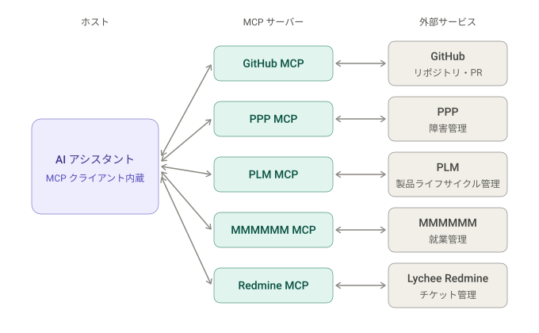
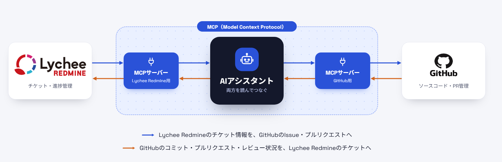

# MCPサーバー

- [MCPサーバーとは](#mcpサーバーとは)
- [MCPサーバーの利点](#mcpサーバーの利点)
- [MCPサーバーの基本動作](#mcpサーバーの基本動作)

## MCPサーバーとは

MCP (Model Context Protocol) サーバーとは、AIが社内データや外部ツールとつながるための共通ルール（プロトコル）に沿って動くプログラムのことです。

Anthropicが2024年11月に発表・公開したオープン標準規格で、現在はLinux Foundation傘下の団体が運営しています。

よく「AI版のUSB-C」と例えられていて、一度作れば、いろいろなAIアプリから使えます。 
Claudeだけでなく、CopilotやCodexなどでも共通の規格で会話ができます。

## MCPサーバーの利点

MCP連携した外部システムに関して、生成AIに作業を任せられるだけでなく、外部システム同士の連携がスムーズにできるようになります。 
(例)GitHubの情報をLychee Redmineに流すのを生成AIに任せるなど。

## MCPサーバーの基本動作

登場するのは次の3つです。

- **MCPクライアント**：Claude Desktop、Claude Code、VS Code など、AIを使うアプリ側
- **MCPサーバー**：GitHubやRedmineなどの外部システムを操作する「ツール」を提供するプログラム
- **AI（モデル）**：ユーザーの依頼を読み、どのツールを使うかを考える

大まかな流れは次のとおりです。

1. MCPクライアントがMCPサーバーに接続する。
2. MCPサーバーから、使えるツールの一覧（名前・説明・必要な引数）を受け取る。
3. ユーザーが依頼を送ると、AIはツールの説明を見て、使うかどうか・どのツールを使うかを判断する。
4. MCPクライアントがMCPサーバーにツールの実行を依頼する。
5. MCPサーバーが外部システムを操作し、結果をMCPクライアントに返す。
6. AIが結果を受け取り、回答を作ったり、次のツールを使ったりする。

> AIが直接外部システムにアクセスするわけではありません。
> AIにできるのは、MCPサーバーが用意したツールの範囲と、設定したアカウントの権限の範囲内の操作だけです。

詳しく知りたい方は、[Claude Academy](https://academy.claude.com/ja/courses/introduction-to-model-context-protocol/mcp-clients) もご覧ください。

