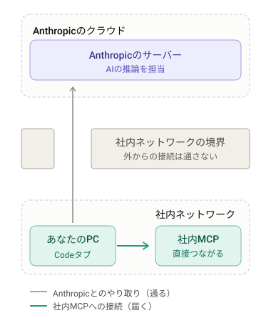

# MCPサーバーの通信方式

主にClaude向けの内容になります。 

- [MCPの接続方式](#mcpの接続方式)
- [MCPサーバーの到達範囲](#mcpサーバーの到達範囲)
- [Claude Desktopの接続について](#claude-desktopの接続について)
  - [リモートMCP (社内HTTP経由MCP) の接続](#リモートmcp-社内http経由mcp-の接続)
  - [ローカルMCPの接続](#ローカルmcpの接続)

## MCPの接続方式

MCPの仕様で決まっている接続方法は3種類あります。 
Claude CodeでMCPサーバーを追加するときも、この中から選びます。

| 方式 | 概要 |
| -- | -- |
| 標準入出力(stdio) | 自分のPC上でMCPサーバーを起動して、直接やりとりする |
| HTTP(Streamable HTTP)| URLを指定して、ネットワーク越しにつなぐ |
| SSE(Server-Sent Events) | 古い方式。現在は非推奨なので、今回は省略 | 

## MCPサーバーの到達範囲

2種類の方式のMCPサーバーの動く場所は下記のようになっています。

- 標準入出力(stdio) : MCPサーバーは自分のPCの中で動く
- HTTP : MCPサーバーは別の場所（社内サーバーなど）で動く。自分のPCでも可。

それらの影響により、MCPサーバーが届く範囲は下記のようにClaudeの媒体によって異なっています。 
ざっくり言うと、接続を張る側がクラウドにいるか、PCにいるかでMCPの到達範囲が異なります。

| 媒体 | インターネット上のHTTP | stdio | 社内HTTP |
| -- | -- | -- | -- |
| Claude.ai (Web) | 〇 | × | × |
| Claude Desktop (Chatタブ) | 〇 | 〇 | △ |
| Claude Code (CLI・VS Code・ Desktop Codeタブ) | 〇 | 〇 | 〇 |

Claude Desktop(Chatタブ)はコネクタ経由だと社内HTTPには届ないですが、中継用npmパッケージを登録すれば可能ではあります。PC 上の中継を使えば可ぐらいに思ってください。

## Claude Desktopの接続について

先ほどの内容を整理すると、Claude DesktopのMCPの到達範囲は下記のようになります。

- Chatタブ
  - リモート社内MCP : 届かない(コネクタ経由)
  - ローカルMCP(stdio) : 届く
- Codeタブ
  - リモート社内MCP : 届く
  - ローカルMCP(stdio) : 届く

### リモートMCP (社内HTTP経由MCP) の接続

- Chatタブ 
  アプリがPCで動いていることは、Chatタブのカスタムコネクタでは助けになりません。接続を張りに行く役目を、Anthropicのクラウド側が受け持つからです。 求められる条件は「インターネット側から、HTTPS標準の443番ポートで入れること」なので、社内からしか見えないサーバーは対象外になります。 図の赤い破線がこの接続で、社内ネットワークの境界で止まります。[claude](https://support.claude.com/en/articles/11175166-get-started-with-custom-connectors-using-remote-mcp)
- Codeタブ 
  Codeタブの強みは、環境が「Local」ならセッションがお手元のPCで動き、.mcp.json や ~/.claude.json に書いたMCPサーバーもそこで読み込まれる点です。 そのため社内MCPへのHTTP接続は社内ネットワークの中で完結し、PCからAnthropicへ出ていくのはAIとのやり取りのほうになります。[claude](https://code.claude.com/docs/en/desktop)

### ローカルMCPの接続

<svg width="40%" viewBox="0 0 380 604" role="img" style="" xmlns="http://www.w3.org/2000/svg" xmlns:c2pa="http://c2pa.org/manifest"><metadata><c2pa:manifest>AAAWkGp1bWIAAAAeanVtZGMycGEAEQAQgAAAqgA4m3EDYzJwYQAAABZqanVtYgAAAEdqdW1kYzJtYQARABCAAACqADibcQN1cm46YzJwYToyMzQ0OGM3Ny1jZjVlLTQ5ZjctODY1OS03MTczZTZhYWI2OGQAAAADf2p1bWIAAAApanVtZGMyYXMAEQAQgAAAqgA4m3EDYzJwYS5hc3NlcnRpb25zAAAAALxqdW1iAAAARGp1bWRjYm9yABEAEIAAAKoAOJtxE2MycGEuaW5ncmVkaWVudC52MwAAAAAYYzJzaLo5JbTqmAKob8lzrqG4pSgAAABwY2JvcqNscmVsYXRpb25zaGlwaHBhcmVudE9maWRjOmZvcm1hdG1pbWFnZS9zdmcreG1samluc3RhbmNlSUR4LHhtcDppaWQ6ZGE3ZTdkYmMtMGY0MC00ZmUwLWEyZGUtMjE5ZjhjNzhkNDIzAAABzmp1bWIAAABBanVtZGNib3IAEQAQgAAAqgA4m3ETYzJwYS5hY3Rpb25zLnYyAAAAABhjMnNoh9mISSqvDIO/PfdYA3rWiQAAAYVjYm9yoWdhY3Rpb25zgqJmYWN0aW9ua2MycGEub3BlbmVkanBhcmFtZXRlcnOha2luZ3JlZGllbnRzgaJjdXJseC1zZWxmI2p1bWJmPWMycGEuYXNzZXJ0aW9ucy9jMnBhLmluZ3JlZGllbnQudjNkaGFzaFggLz+1TAieVzU731+gzr38lNajtPbykKe/aNIedzFbm7GkZmFjdGlvbngdY29tLmFudGhyb3BpYy5jbGF1ZGUucHJvdmlkZWRtc29mdHdhcmVBZ2VudKFkbmFtZWZDbGF1ZGVqcGFyYW1ldGVyc6F4H2NvbS5hbnRocm9waWMub3JpZ2luLWNvbmZpZGVuY2VndW5rbm93bmtkZXNjcmlwdGlvbnhmQ2xhdWRlIHByb3ZpZGVkIHRoaXMgZmlsZSBhdCB0aGUgcmVxdWVzdCBvZiBhIHVzZXIgYW5kIG1heSBoYXZlIGNyZWF0ZWQgb3IgbW9kaWZpZWQgdGhlIGZpbGUgY29udGVudHMuAAAAxGp1bWIAAABAanVtZGNib3IAEQAQgAAAqgA4m3ETYzJwYS5oYXNoLmRhdGEAAAAAGGMyc2jJpsHiWq3+4XGKND0m07+OAAAAfGNib3KlamV4Y2x1c2lvbnOBomVzdGFydBieZmxlbmd0aBkeGGRuYW1lbmp1bWJmIG1hbmlmZXN0Y2FsZ2ZzaGEyNTZkaGFzaFgg+BicVFjrzyEcimN0es5KRhooZH4fV8oz79vanxsMxJZjcGFkSQAAAAAAAAAAAAAAAmRqdW1iAAAAJ2p1bWRjMmNsABEAEIAAAKoAOJtxA2MycGEuY2xhaW0udjIAAAACNWNib3Kmamluc3RhbmNlSUR4LHhtcDppaWQ6OTlmMjZhNDQtZGY5ZC00NDJjLTg1MDEtYjY0OWE4ZWJhNzkzdGNsYWltX2dlbmVyYXRvcl9pbmZvo2RuYW1lc0FudGhyb3BpYyBDbGF1ZGUuYWlndmVyc2lvbmUxLjAuMHdvcmcuY29udGVudGF1dGguYzJwYV9yc2YwLjkwLjBpc2lnbmF0dXJleE1zZWxmI2p1bWJmPS9jMnBhL3VybjpjMnBhOjIzNDQ4Yzc3LWNmNWUtNDlmNy04NjU5LTcxNzNlNmFhYjY4ZC9jMnBhLnNpZ25hdHVyZXJjcmVhdGVkX2Fzc2VydGlvbnOComN1cmx4KnNlbGYjanVtYmY9YzJwYS5hc3NlcnRpb25zL2MycGEuYWN0aW9ucy52MmRoYXNoWCCtysBpRp1wP+3x753RVNHZSRmuKDcNpEOcRLh2iXojT6JjdXJseClzZWxmI2p1bWJmPWMycGEuYXNzZXJ0aW9ucy9jMnBhLmhhc2guZGF0YWRoYXNoWCAx449hY3Wl0rdkqp2dArns+y1FVhE1qBU4MRrjVu4P3HNnYXRoZXJlZF9hc3NlcnRpb25zgaJjdXJseC1zZWxmI2p1bWJmPWMycGEuYXNzZXJ0aW9ucy9jMnBhLmluZ3JlZGllbnQudjNkaGFzaFggLz+1TAieVzU731+gzr38lNajtPbykKe/aNIedzFbm7FjYWxnZnNoYTI1NgAAEDhqdW1iAAAAKGp1bWRjMmNzABEAEIAAAKoAOJtxA2MycGEuc2lnbmF0dXJlAAAAEAhjYm9y0oRZAhKiASYYIVkCCjCCAgYwggGNoAMCAQICFEDloAruwjnQvriD+gZCBT1nVRMAMAoGCCqGSM49BAMDMEkxFzAVBgNVBAoTDkFudGhyb3BpYywgUEJDMS4wLAYDVQQDEyVBbnRocm9waWMgQ29udGVudCBDcmVkZW50aWFscyBSb290IENBMB4XDTI2MDgwNzE4NDM1NloXDTI4MDgwNjE5NDM1NlowRDEXMBUGA1UEChMOQW50aHJvcGljLCBQQkMxKTAnBgNVBAMTIEFudGhyb3BpYyBDbGF1ZGUgQ29udGVudCBTaWduaW5nMFkwEwYHKoZIzj0CAQYIKoZIzj0DAQcDQgAEmHoKa8tQGAUU1TS9QqU5W0Tp2N3XsvlK7BfQt6YWKwEzd2R3/dzKPEUDdCjlLjp9fT+KFjRVnuZ9v0oXvTe3k6NYMFYwDgYDVR0PAQH/BAQDAgeAMBUGA1UdJQQOMAwGCisGAQQBg+heAgEwDAYDVR0TAQH/BAIwADAfBgNVHSMEGDAWgBTOUeIEgU5kWyP448TPmj6cwddcwjAKBggqhkjOPQQDAwNnADBkAjAxcx0UngF60stVjs5G4T2eiptsBk5mf9oCtfJPAUBl8qs/PEXa8+gk1/X5QJ2DVcYCMHBfXN31YapiSqYvlIWrDVDJKOvXMl+kkz37Wt0PBI8sw486Mq6JeOhT+lRR4b1HCaFjcGFkWQ2eAAAAAAAAAAAAAAAAAAAAAAAAAAAAAAAAAAAAAAAAAAAAAAAAAAAAAAAAAAAAAAAAAAAAAAAAAAAAAAAAAAAAAAAAAAAAAAAAAAAAAAAAAAAAAAAAAAAAAAAAAAAAAAAAAAAAAAAAAAAAAAAAAAAAAAAAAAAAAAAAAAAAAAAAAAAAAAAAAAAAAAAAAAAAAAAAAAAAAAAAAAAAAAAAAAAAAAAAAAAAAAAAAAAAAAAAAAAAAAAAAAAAAAAAAAAAAAAAAAAAAAAAAAAAAAAAAAAAAAAAAAAAAAAAAAAAAAAAAAAAAAAAAAAAAAAAAAAAAAAAAAAAAAAAAAAAAAAAAAAAAAAAAAAAAAAAAAAAAAAAAAAAAAAAAAAAAAAAAAAAAAAAAAAAAAAAAAAAAAAAAAAAAAAAAAAAAAAAAAAAAAAAAAAAAAAAAAAAAAAAAAAAAAAAAAAAAAAAAAAAAAAAAAAAAAAAAAAAAAAAAAAAAAAAAAAAAAAAAAAAAAAAAAAAAAAAAAAAAAAAAAAAAAAAAAAAAAAAAAAAAAAAAAAAAAAAAAAAAAAAAAAAAAAAAAAAAAAAAAAAAAAAAAAAAAAAAAAAAAAAAAAAAAAAAAAAAAAAAAAAAAAAAAAAAAAAAAAAAAAAAAAAAAAAAAAAAAAAAAAAAAAAAAAAAAAAAAAAAAAAAAAAAAAAAAAAAAAAAAAAAAAAAAAAAAAAAAAAAAAAAAAAAAAAAAAAAAAAAAAAAAAAAAAAAAAAAAAAAAAAAAAAAAAAAAAAAAAAAAAAAAAAAAAAAAAAAAAAAAAAAAAAAAAAAAAAAAAAAAAAAAAAAAAAAAAAAAAAAAAAAAAAAAAAAAAAAAAAAAAAAAAAAAAAAAAAAAAAAAAAAAAAAAAAAAAAAAAAAAAAAAAAAAAAAAAAAAAAAAAAAAAAAAAAAAAAAAAAAAAAAAAAAAAAAAAAAAAAAAAAAAAAAAAAAAAAAAAAAAAAAAAAAAAAAAAAAAAAAAAAAAAAAAAAAAAAAAAAAAAAAAAAAAAAAAAAAAAAAAAAAAAAAAAAAAAAAAAAAAAAAAAAAAAAAAAAAAAAAAAAAAAAAAAAAAAAAAAAAAAAAAAAAAAAAAAAAAAAAAAAAAAAAAAAAAAAAAAAAAAAAAAAAAAAAAAAAAAAAAAAAAAAAAAAAAAAAAAAAAAAAAAAAAAAAAAAAAAAAAAAAAAAAAAAAAAAAAAAAAAAAAAAAAAAAAAAAAAAAAAAAAAAAAAAAAAAAAAAAAAAAAAAAAAAAAAAAAAAAAAAAAAAAAAAAAAAAAAAAAAAAAAAAAAAAAAAAAAAAAAAAAAAAAAAAAAAAAAAAAAAAAAAAAAAAAAAAAAAAAAAAAAAAAAAAAAAAAAAAAAAAAAAAAAAAAAAAAAAAAAAAAAAAAAAAAAAAAAAAAAAAAAAAAAAAAAAAAAAAAAAAAAAAAAAAAAAAAAAAAAAAAAAAAAAAAAAAAAAAAAAAAAAAAAAAAAAAAAAAAAAAAAAAAAAAAAAAAAAAAAAAAAAAAAAAAAAAAAAAAAAAAAAAAAAAAAAAAAAAAAAAAAAAAAAAAAAAAAAAAAAAAAAAAAAAAAAAAAAAAAAAAAAAAAAAAAAAAAAAAAAAAAAAAAAAAAAAAAAAAAAAAAAAAAAAAAAAAAAAAAAAAAAAAAAAAAAAAAAAAAAAAAAAAAAAAAAAAAAAAAAAAAAAAAAAAAAAAAAAAAAAAAAAAAAAAAAAAAAAAAAAAAAAAAAAAAAAAAAAAAAAAAAAAAAAAAAAAAAAAAAAAAAAAAAAAAAAAAAAAAAAAAAAAAAAAAAAAAAAAAAAAAAAAAAAAAAAAAAAAAAAAAAAAAAAAAAAAAAAAAAAAAAAAAAAAAAAAAAAAAAAAAAAAAAAAAAAAAAAAAAAAAAAAAAAAAAAAAAAAAAAAAAAAAAAAAAAAAAAAAAAAAAAAAAAAAAAAAAAAAAAAAAAAAAAAAAAAAAAAAAAAAAAAAAAAAAAAAAAAAAAAAAAAAAAAAAAAAAAAAAAAAAAAAAAAAAAAAAAAAAAAAAAAAAAAAAAAAAAAAAAAAAAAAAAAAAAAAAAAAAAAAAAAAAAAAAAAAAAAAAAAAAAAAAAAAAAAAAAAAAAAAAAAAAAAAAAAAAAAAAAAAAAAAAAAAAAAAAAAAAAAAAAAAAAAAAAAAAAAAAAAAAAAAAAAAAAAAAAAAAAAAAAAAAAAAAAAAAAAAAAAAAAAAAAAAAAAAAAAAAAAAAAAAAAAAAAAAAAAAAAAAAAAAAAAAAAAAAAAAAAAAAAAAAAAAAAAAAAAAAAAAAAAAAAAAAAAAAAAAAAAAAAAAAAAAAAAAAAAAAAAAAAAAAAAAAAAAAAAAAAAAAAAAAAAAAAAAAAAAAAAAAAAAAAAAAAAAAAAAAAAAAAAAAAAAAAAAAAAAAAAAAAAAAAAAAAAAAAAAAAAAAAAAAAAAAAAAAAAAAAAAAAAAAAAAAAAAAAAAAAAAAAAAAAAAAAAAAAAAAAAAAAAAAAAAAAAAAAAAAAAAAAAAAAAAAAAAAAAAAAAAAAAAAAAAAAAAAAAAAAAAAAAAAAAAAAAAAAAAAAAAAAAAAAAAAAAAAAAAAAAAAAAAAAAAAAAAAAAAAAAAAAAAAAAAAAAAAAAAAAAAAAAAAAAAAAAAAAAAAAAAAAAAAAAAAAAAAAAAAAAAAAAAAAAAAAAAAAAAAAAAAAAAAAAAAAAAAAAAAAAAAAAAAAAAAAAAAAAAAAAAAAAAAAAAAAAAAAAAAAAAAAAAAAAAAAAAAAAAAAAAAAAAAAAAAAAAAAAAAAAAAAAAAAAAAAAAAAAAAAAAAAAAAAAAAAAAAAAAAAAAAAAAAAAAAAAAAAAAAAAAAAAAAAAAAAAAAAAAAAAAAAAAAAAAAAAAAAAAAAAAAAAAAAAAAAAAAAAAAAAAAAAAAAAAAAAAAAAAAAAAAAAAAAAAAAAAAAAAAAAAAAAAAAAAAAAAAAAAAAAAAAAAAAAAAAAAAAAAAAAAAAAAAAAAAAAAAAAAAAAAAAAAAAAAAAAAAAAAAAAAAAAAAAAAAAAAAAAAAAAAAAAAAAAAAAAAAAAAAAAAAAAAAAAAAAAAAAAAAAAAAAAAAAAAAAAAAAAAAAAAAAAAAAAAAAAAAAAAAAAAAAAAAAAAAAAAAAAAAAAAAAAAAAAAAAAAAAAAAAAAAAAAAAAAAAAAAAAAAAAAAAAAAAAAAAAAAAAAAAAAAAAAAAAAAAAAAAAAAAAAAAAAAAAAAAAAAAAAAAAAAAAAAAAAAAAAAAAAAAAAAAAAAAAAAAAAAAAAAAAAAAAAAAAAAAAAAAAAAAAAAAAAAAAAAAAAAAAAAAAAAAAAAAAAAAAAAAAAAAAAAAAAAAAAAAAAAAAAAAAAAAAAAAAAAAAAAAAAAAAAAAAAAAAAAAAAAAAAAAAAAAAAAAAAAAAAAAAAAAAAAAAAAAAAAAAAAAAAAAAAAAAAAAAAAAAAAAAAAAAAAAAAAAAAAAAAAAAAAAAAAAAAAAAAAAAAAAAAAAAAAAAAAAAAAAAAAAAAAAAAAAAAAAAAAAAAAAAAAAAAAAAAAAAAAAAAAAAAAAAAAAAAAAAAAAAAAAAAAAAAAAAAAAAAAAAAAAAAAAAAAAAAAAAAAAAAAAAAAAAAAAAAAAAAAAAAAAAAAAAAAAAAAAAAAAAAAAAAAAAAAAAAAAAAAAAAAAAAAAAAAAAAAAAAAAAAAAAAAAAAAAAAAAAAAAAAAAAAAAAAAAAAAAAAAAAAAAAAAAAAAAAAAAAAAAAAAAAAAAAAAAAAAAAAAAAAAAAAAAAAAAAAAAAAAAAAAAAAAAAAAAAAAAAAAAAAAAAAAAAAAAAAAAAAAAAAAAAAAAAAAAAAAAAAAAAAAAAAAAAAAAAAAAAAAAAAAAAAAAAAAAAAAAAAAAAAAAAAAAAAAAAAAAAAAAAAAAAAAAAAAAAAAAAAAAAAAAAAAAAAAAAAAAAAAAAAAAAAAAAAAAAAAAAAAAAAAAAAAAAAAAAAAAAAAAAAAAAAAAAAAAAAAAAAAAAAAAAAAAAAAAAAAAAAAAAAAAAAAAAAAAAAAAAAAAAAAAAAAAAAAAAAAAAAAAAAAAAAAAAAAAAAAAAAAAAAAAAAAAAAAAAAAAAAAAAAAAAAAAAAAAAAAAAAAAAAAAAAAAAAAAAAAAAAAAAAAAAAAAAAAAAAAAAAAAAAAAAAAAAAAAAAAAAAAAAAAAAAAAAAAAAAAAAAAAAAAAAAAAAAAAAAAAAAAAAAAAAAAAAAAAAAAAAAAAAAAAAAAAAAAAAAAAAAAAAAAAAAAAAAAAAAAAAAAAAAAAAAAAAAAAAAAAAAAAAAAAAAAAAAAAAAAAAAAAAAAAAAAAAAAAAAAAAAAAAAAAAAAAAAAAAAAAAAAAAAAAAAAAAAAAAAAAAAAAAAAAAAAAAAAAAAAAAAAAAAAAAAAAAAAAAAAAAAAAAAAAAAAAAAAAAAAAAAAAAAAAAAAAAAAAAAAAAAAAAAAAAAAAAAAAAAAAAAAAAAAAAAAAAAAAAAAAAAAAAAAAAAAAAAAAAAAAAAAAAAAAAAAAAAAAAAAAAAAAAAAAAAAAAAAAAAAAAAAAAAAAAAAAAAAAAAAAAAAAAAAAAAAAAAAAAAAAAAAAAAAAAAAAAAAAAAA9lhALzC3R4L8zBNz1vZBwXqzmnKh2DN3V19NAH24JKj1UimaquwrVt9FGyhltv1P0ifw7tfZsuO/4dTCPDVvgsXx/A==</c2pa:manifest></metadata>
<title style="fill:rgb(0, 0, 0);stroke:none;color:rgb(11, 11, 11);stroke-width:1px;stroke-linecap:butt;stroke-linejoin:miter;opacity:1;font-family:anthropic-sans, ui-sans-serif, system-ui, -apple-system, &quot;Segoe UI&quot;, Roboto, sans-serif;font-size:16px;font-weight:400;text-anchor:start;dominant-baseline:auto">Chatタブでもstdioなら社内に届く構図</title>
<desc style="fill:rgb(0, 0, 0);stroke:none;color:rgb(11, 11, 11);stroke-width:1px;stroke-linecap:butt;stroke-linejoin:miter;opacity:1;font-family:anthropic-sans, ui-sans-serif, system-ui, -apple-system, &quot;Segoe UI&quot;, Roboto, sans-serif;font-size:16px;font-weight:400;text-anchor:start;dominant-baseline:auto">Chatタブがstdioで会話するMCPサーバーはPC上のプロセスとして動き、社内ネットワークの中から社内サーバーへ直接接続する。社内ネットワークの境界をまたぐのは、PCからAnthropicへのやり取りのほうである。</desc>
<defs><marker id="arrow" viewBox="0 0 10 10" refX="8" refY="5" markerWidth="6" markerHeight="6" orient="auto-start-reverse"><path d="M2 1L8 5L2 9" fill="none" stroke="context-stroke" stroke-width="1.5" stroke-linecap="round" stroke-linejoin="round" style="stroke:#898781;stroke:context-stroke;"/></marker></defs>
<rect x="30" y="20" width="320" height="116" rx="12" stroke-dasharray="4 3" style="fill:rgb(252, 252, 251);stroke:hsl(none 0% 4.31373% / 0.2);color:rgb(11, 11, 11);stroke-width:1px;stroke-dasharray:4px, 3px;stroke-linecap:butt;stroke-linejoin:miter;opacity:1;font-family:anthropic-sans, ui-sans-serif, system-ui, -apple-system, &quot;Segoe UI&quot;, Roboto, sans-serif;font-size:16px;font-weight:400;text-anchor:start;dominant-baseline:auto"/>
<text x="46" y="40" dominant-baseline="central" style="fill:rgb(11, 11, 11);stroke:none;color:rgb(11, 11, 11);stroke-width:1px;stroke-linecap:butt;stroke-linejoin:miter;opacity:1;font-family:anthropic-sans, ui-sans-serif, system-ui, -apple-system, &quot;Segoe UI&quot;, Roboto, sans-serif;font-size:14px;font-weight:500;text-anchor:start;dominant-baseline:central">Anthropicのクラウド</text>
<rect x="30" y="280" width="320" height="256" rx="12" stroke-dasharray="4 3" style="fill:rgb(252, 252, 251);stroke:hsl(none 0% 4.31373% / 0.2);color:rgb(11, 11, 11);stroke-width:1px;stroke-dasharray:4px, 3px;stroke-linecap:butt;stroke-linejoin:miter;opacity:1;font-family:anthropic-sans, ui-sans-serif, system-ui, -apple-system, &quot;Segoe UI&quot;, Roboto, sans-serif;font-size:16px;font-weight:400;text-anchor:start;dominant-baseline:auto"/>
<text x="218" y="299" dominant-baseline="central" style="fill:rgb(11, 11, 11);stroke:none;color:rgb(11, 11, 11);stroke-width:1px;stroke-linecap:butt;stroke-linejoin:miter;opacity:1;font-family:anthropic-sans, ui-sans-serif, system-ui, -apple-system, &quot;Segoe UI&quot;, Roboto, sans-serif;font-size:14px;font-weight:500;text-anchor:start;dominant-baseline:central">社内ネットワーク</text>
<rect x="42" y="316" width="296" height="104" rx="8" style="fill:rgb(252, 252, 251);stroke:hsl(none 0% 4.31373% / 0.2);color:rgb(11, 11, 11);stroke-width:1px;stroke-linecap:butt;stroke-linejoin:miter;opacity:1;font-family:anthropic-sans, ui-sans-serif, system-ui, -apple-system, &quot;Segoe UI&quot;, Roboto, sans-serif;font-size:16px;font-weight:400;text-anchor:start;dominant-baseline:auto"/>
<text x="56" y="334" dominant-baseline="central" style="fill:rgb(11, 11, 11);stroke:none;color:rgb(11, 11, 11);stroke-width:1px;stroke-linecap:butt;stroke-linejoin:miter;opacity:1;font-family:anthropic-sans, ui-sans-serif, system-ui, -apple-system, &quot;Segoe UI&quot;, Roboto, sans-serif;font-size:14px;font-weight:500;text-anchor:start;dominant-baseline:central">あなたのPC</text>
<line x1="102" y1="312" x2="102" y2="122" marker-end="url(#arrow)" style="fill:none;stroke:rgb(137, 135, 129);color:rgb(11, 11, 11);stroke-width:1.5px;stroke-linecap:butt;stroke-linejoin:miter;opacity:1;font-family:anthropic-sans, ui-sans-serif, system-ui, -apple-system, &quot;Segoe UI&quot;, Roboto, sans-serif;font-size:16px;font-weight:400;text-anchor:start;dominant-baseline:auto"/>
<line x1="168" y1="380" x2="206" y2="380" style="stroke:#1D9E75;stroke-width:2;fill:none;stroke:rgb(29, 158, 117);color:rgb(11, 11, 11);stroke-width:2px;stroke-linecap:butt;stroke-linejoin:miter;opacity:1;font-family:anthropic-sans, ui-sans-serif, system-ui, -apple-system, &quot;Segoe UI&quot;, Roboto, sans-serif;font-size:16px;font-weight:400;text-anchor:start;dominant-baseline:auto" marker-end="url(#arrow)"/>
<line x1="271" y1="412" x2="271" y2="458" style="stroke:#1D9E75;stroke-width:2;fill:none;stroke:rgb(29, 158, 117);color:rgb(11, 11, 11);stroke-width:2px;stroke-linecap:butt;stroke-linejoin:miter;opacity:1;font-family:anthropic-sans, ui-sans-serif, system-ui, -apple-system, &quot;Segoe UI&quot;, Roboto, sans-serif;font-size:16px;font-weight:400;text-anchor:start;dominant-baseline:auto" marker-end="url(#arrow)"/>
<g style="fill:rgb(0, 0, 0);stroke:none;color:rgb(11, 11, 11);stroke-width:1px;stroke-linecap:butt;stroke-linejoin:miter;opacity:1;font-family:anthropic-sans, ui-sans-serif, system-ui, -apple-system, &quot;Segoe UI&quot;, Roboto, sans-serif;font-size:16px;font-weight:400;text-anchor:start;dominant-baseline:auto">
<rect x="42" y="56" width="296" height="56" rx="8" stroke-width="0.5" style="fill:rgb(238, 237, 254);stroke:rgb(83, 74, 183);color:rgb(11, 11, 11);stroke-width:0.5px;stroke-linecap:butt;stroke-linejoin:miter;opacity:1;font-family:anthropic-sans, ui-sans-serif, system-ui, -apple-system, &quot;Segoe UI&quot;, Roboto, sans-serif;font-size:16px;font-weight:400;text-anchor:start;dominant-baseline:auto"/>
<text x="190" y="74" text-anchor="middle" dominant-baseline="central" style="fill:rgb(60, 52, 137);stroke:none;color:rgb(11, 11, 11);stroke-width:1px;stroke-linecap:butt;stroke-linejoin:miter;opacity:1;font-family:anthropic-sans, ui-sans-serif, system-ui, -apple-system, &quot;Segoe UI&quot;, Roboto, sans-serif;font-size:14px;font-weight:500;text-anchor:middle;dominant-baseline:central">Anthropicのサーバー</text>
<text x="190" y="94" text-anchor="middle" dominant-baseline="central" style="fill:rgb(83, 74, 183);stroke:none;color:rgb(11, 11, 11);stroke-width:1px;stroke-linecap:butt;stroke-linejoin:miter;opacity:1;font-family:anthropic-sans, ui-sans-serif, system-ui, -apple-system, &quot;Segoe UI&quot;, Roboto, sans-serif;font-size:12px;font-weight:400;text-anchor:middle;dominant-baseline:central">AIの推論を担当</text>
</g>
<g style="fill:rgb(0, 0, 0);stroke:none;color:rgb(11, 11, 11);stroke-width:1px;stroke-linecap:butt;stroke-linejoin:miter;opacity:1;font-family:anthropic-sans, ui-sans-serif, system-ui, -apple-system, &quot;Segoe UI&quot;, Roboto, sans-serif;font-size:16px;font-weight:400;text-anchor:start;dominant-baseline:auto">
<rect x="30" y="180" width="46" height="56" rx="4" stroke-width="0.5" style="fill:rgb(241, 239, 232);stroke:rgb(95, 94, 90);color:rgb(11, 11, 11);stroke-width:0.5px;stroke-linecap:butt;stroke-linejoin:miter;opacity:1;font-family:anthropic-sans, ui-sans-serif, system-ui, -apple-system, &quot;Segoe UI&quot;, Roboto, sans-serif;font-size:16px;font-weight:400;text-anchor:start;dominant-baseline:auto"/>
<rect x="128" y="180" width="222" height="56" rx="4" stroke-width="0.5" style="fill:rgb(241, 239, 232);stroke:rgb(95, 94, 90);color:rgb(11, 11, 11);stroke-width:0.5px;stroke-linecap:butt;stroke-linejoin:miter;opacity:1;font-family:anthropic-sans, ui-sans-serif, system-ui, -apple-system, &quot;Segoe UI&quot;, Roboto, sans-serif;font-size:16px;font-weight:400;text-anchor:start;dominant-baseline:auto"/>
<text x="239" y="198" text-anchor="middle" dominant-baseline="central" style="fill:rgb(68, 68, 65);stroke:none;color:rgb(11, 11, 11);stroke-width:1px;stroke-linecap:butt;stroke-linejoin:miter;opacity:1;font-family:anthropic-sans, ui-sans-serif, system-ui, -apple-system, &quot;Segoe UI&quot;, Roboto, sans-serif;font-size:14px;font-weight:500;text-anchor:middle;dominant-baseline:central">社内ネットワークの境界</text>
<text x="239" y="218" text-anchor="middle" dominant-baseline="central" style="fill:rgb(95, 94, 90);stroke:none;color:rgb(11, 11, 11);stroke-width:1px;stroke-linecap:butt;stroke-linejoin:miter;opacity:1;font-family:anthropic-sans, ui-sans-serif, system-ui, -apple-system, &quot;Segoe UI&quot;, Roboto, sans-serif;font-size:12px;font-weight:400;text-anchor:middle;dominant-baseline:central">外からの接続は通さない</text>
</g>
<g style="fill:rgb(0, 0, 0);stroke:none;color:rgb(11, 11, 11);stroke-width:1px;stroke-linecap:butt;stroke-linejoin:miter;opacity:1;font-family:anthropic-sans, ui-sans-serif, system-ui, -apple-system, &quot;Segoe UI&quot;, Roboto, sans-serif;font-size:16px;font-weight:400;text-anchor:start;dominant-baseline:auto">
<rect x="54" y="352" width="110" height="56" rx="8" stroke-width="0.5" style="fill:rgb(225, 245, 238);stroke:rgb(15, 110, 86);color:rgb(11, 11, 11);stroke-width:0.5px;stroke-linecap:butt;stroke-linejoin:miter;opacity:1;font-family:anthropic-sans, ui-sans-serif, system-ui, -apple-system, &quot;Segoe UI&quot;, Roboto, sans-serif;font-size:16px;font-weight:400;text-anchor:start;dominant-baseline:auto"/>
<text x="109" y="370" text-anchor="middle" dominant-baseline="central" style="fill:rgb(8, 80, 65);stroke:none;color:rgb(11, 11, 11);stroke-width:1px;stroke-linecap:butt;stroke-linejoin:miter;opacity:1;font-family:anthropic-sans, ui-sans-serif, system-ui, -apple-system, &quot;Segoe UI&quot;, Roboto, sans-serif;font-size:14px;font-weight:500;text-anchor:middle;dominant-baseline:central">Chatタブ</text>
<text x="109" y="390" text-anchor="middle" dominant-baseline="central" style="fill:rgb(15, 110, 86);stroke:none;color:rgb(11, 11, 11);stroke-width:1px;stroke-linecap:butt;stroke-linejoin:miter;opacity:1;font-family:anthropic-sans, ui-sans-serif, system-ui, -apple-system, &quot;Segoe UI&quot;, Roboto, sans-serif;font-size:12px;font-weight:400;text-anchor:middle;dominant-baseline:central">stdioで会話</text>
</g>
<g style="fill:rgb(0, 0, 0);stroke:none;color:rgb(11, 11, 11);stroke-width:1px;stroke-linecap:butt;stroke-linejoin:miter;opacity:1;font-family:anthropic-sans, ui-sans-serif, system-ui, -apple-system, &quot;Segoe UI&quot;, Roboto, sans-serif;font-size:16px;font-weight:400;text-anchor:start;dominant-baseline:auto">
<rect x="216" y="352" width="110" height="56" rx="8" stroke-width="0.5" style="fill:rgb(225, 245, 238);stroke:rgb(15, 110, 86);color:rgb(11, 11, 11);stroke-width:0.5px;stroke-linecap:butt;stroke-linejoin:miter;opacity:1;font-family:anthropic-sans, ui-sans-serif, system-ui, -apple-system, &quot;Segoe UI&quot;, Roboto, sans-serif;font-size:16px;font-weight:400;text-anchor:start;dominant-baseline:auto"/>
<text x="271" y="370" text-anchor="middle" dominant-baseline="central" style="fill:rgb(8, 80, 65);stroke:none;color:rgb(11, 11, 11);stroke-width:1px;stroke-linecap:butt;stroke-linejoin:miter;opacity:1;font-family:anthropic-sans, ui-sans-serif, system-ui, -apple-system, &quot;Segoe UI&quot;, Roboto, sans-serif;font-size:14px;font-weight:500;text-anchor:middle;dominant-baseline:central">stdio MCP</text>
<text x="271" y="390" text-anchor="middle" dominant-baseline="central" style="fill:rgb(15, 110, 86);stroke:none;color:rgb(11, 11, 11);stroke-width:1px;stroke-linecap:butt;stroke-linejoin:miter;opacity:1;font-family:anthropic-sans, ui-sans-serif, system-ui, -apple-system, &quot;Segoe UI&quot;, Roboto, sans-serif;font-size:12px;font-weight:400;text-anchor:middle;dominant-baseline:central">PC上で動く</text>
</g>
<g style="fill:rgb(0, 0, 0);stroke:none;color:rgb(11, 11, 11);stroke-width:1px;stroke-linecap:butt;stroke-linejoin:miter;opacity:1;font-family:anthropic-sans, ui-sans-serif, system-ui, -apple-system, &quot;Segoe UI&quot;, Roboto, sans-serif;font-size:16px;font-weight:400;text-anchor:start;dominant-baseline:auto">
<rect x="211" y="468" width="120" height="56" rx="8" stroke-width="0.5" style="fill:rgb(225, 245, 238);stroke:rgb(15, 110, 86);color:rgb(11, 11, 11);stroke-width:0.5px;stroke-linecap:butt;stroke-linejoin:miter;opacity:1;font-family:anthropic-sans, ui-sans-serif, system-ui, -apple-system, &quot;Segoe UI&quot;, Roboto, sans-serif;font-size:16px;font-weight:400;text-anchor:start;dominant-baseline:auto"/>
<text x="271" y="486" text-anchor="middle" dominant-baseline="central" style="fill:rgb(8, 80, 65);stroke:none;color:rgb(11, 11, 11);stroke-width:1px;stroke-linecap:butt;stroke-linejoin:miter;opacity:1;font-family:anthropic-sans, ui-sans-serif, system-ui, -apple-system, &quot;Segoe UI&quot;, Roboto, sans-serif;font-size:14px;font-weight:500;text-anchor:middle;dominant-baseline:central">社内サーバー</text>
<text x="271" y="506" text-anchor="middle" dominant-baseline="central" style="fill:rgb(15, 110, 86);stroke:none;color:rgb(11, 11, 11);stroke-width:1px;stroke-linecap:butt;stroke-linejoin:miter;opacity:1;font-family:anthropic-sans, ui-sans-serif, system-ui, -apple-system, &quot;Segoe UI&quot;, Roboto, sans-serif;font-size:12px;font-weight:400;text-anchor:middle;dominant-baseline:central">直接つながる</text>
</g>
<line x1="42" y1="560" x2="66" y2="560" style="fill:none;stroke:rgb(137, 135, 129);color:rgb(11, 11, 11);stroke-width:1.5px;stroke-linecap:butt;stroke-linejoin:miter;opacity:1;font-family:anthropic-sans, ui-sans-serif, system-ui, -apple-system, &quot;Segoe UI&quot;, Roboto, sans-serif;font-size:16px;font-weight:400;text-anchor:start;dominant-baseline:auto"/>
<text x="74" y="560" dominant-baseline="central" style="fill:rgb(82, 81, 78);stroke:none;color:rgb(11, 11, 11);stroke-width:1px;stroke-linecap:butt;stroke-linejoin:miter;opacity:1;font-family:anthropic-sans, ui-sans-serif, system-ui, -apple-system, &quot;Segoe UI&quot;, Roboto, sans-serif;font-size:12px;font-weight:400;text-anchor:start;dominant-baseline:central">Anthropicとのやり取り（通る）</text>
<line x1="42" y1="580" x2="66" y2="580" style="stroke:#1D9E75;stroke-width:2;fill:none;stroke:rgb(29, 158, 117);color:rgb(11, 11, 11);stroke-width:2px;stroke-linecap:butt;stroke-linejoin:miter;opacity:1;font-family:anthropic-sans, ui-sans-serif, system-ui, -apple-system, &quot;Segoe UI&quot;, Roboto, sans-serif;font-size:16px;font-weight:400;text-anchor:start;dominant-baseline:auto"/>
<text x="74" y="580" dominant-baseline="central" style="fill:rgb(82, 81, 78);stroke:none;color:rgb(11, 11, 11);stroke-width:1px;stroke-linecap:butt;stroke-linejoin:miter;opacity:1;font-family:anthropic-sans, ui-sans-serif, system-ui, -apple-system, &quot;Segoe UI&quot;, Roboto, sans-serif;font-size:12px;font-weight:400;text-anchor:start;dominant-baseline:central">MCPの経路（届く）</text>
</svg>

Claude DesktopのChatタブでもローカルMCP(stdio)方式の場合は接続可能です。

- stdioという方式の要点は、MCPサーバーがお手元のマシン上のプロセスとして起動される点です。 
- Chatタブでも届く理由は、claude_desktop_config.json に定義したローカルMCPサーバーがコネクタとは別の仕組みで、PC側のネットワークを使うからです。 
- 定義を1か所に書けば済むのも利点で、DesktopのチャットとCodeタブのローカルセッションの両方から同じサーバーを呼べます。 
- claude.ai（Web版）やクラウドで動くセッションからは呼べません。 

