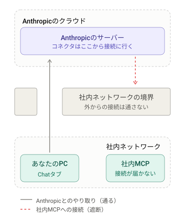
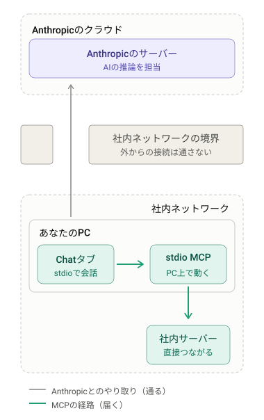

# MCPサーバーの通信方式

主にClaude向けの内容になります。 

## MCPの接続方式

MCPの仕様で決まっている接続方法は3種類あります。 
Claude CodeでMCPサーバーを追加するときも、この中から選びます。

| 方式 | 概要 |
| -- | -- |
| 標準入出力(stdio) | 自分のPC上でMCPサーバーを起動して、直接やりとりする |
| HTTP(Streamable HTTP)| URLを指定して、ネットワーク越しにつなぐ |
| SSE(Server-Sent Events) | 古い方式。現在は非推奨なので、今回は省略 | 

## MCPサーバーの到達範囲

2種類の方式のMCPサーバーの動く場所は下記のようになっています。

- 標準入出力(stdio) : MCPサーバーは自分のPCの中で動く
- HTTP : MCPサーバーは別の場所（社内サーバーなど）で動く。自分のPCでも可。

それらの影響により、MCPサーバーが届く範囲は下記のようにClaudeの媒体によって異なっています。 
ざっくり言うと、接続を張る側がクラウドにいるか、PCにいるかでMCPの到達範囲が異なります。

| 媒体 | インターネット上のHTTP | stdio | 社内HTTP |
| -- | -- | -- | -- |
| Claude.ai (Web) | 〇 | × | × |
| Claude Desktop (Chatタブ) | 〇 | 〇 | △ |
| Claude Code (CLI・VS Code・ Desktop Codeタブ) | 〇 | 〇 | 〇 |

Claude Desktop(Chatタブ)はコネクタ経由だと社内HTTPには届ないですが、中継用npmパッケージを登録すれば可能ではあります。PC 上の中継を使えば可ぐらいに思ってください。

## Claude Desktopの接続について

先ほどの内容を整理すると、Claude DesktopのMCPの到達範囲は下記のようになります。

- Chatタブ
  - リモート社内MCP : 届かない(コネクタ経由)
  - ローカルMCP(stdio) : 届く
- Codeタブ
  - リモート社内MCP : 届く
  - ローカルMCP(stdio) : 届く

### リモートMCP (社内HTTP経由MCP) の接続

- Chatタブ 
  アプリがPCで動いていることは、Chatタブのカスタムコネクタでは助けになりません。接続を張りに行く役目を、Anthropicのクラウド側が受け持つからです。 求められる条件は「インターネット側から、HTTPS標準の443番ポートで入れること」なので、社内からしか見えないサーバーは対象外になります。 図の赤い破線がこの接続で、社内ネットワークの境界で止まります。[claude](https://support.claude.com/en/articles/11175166-get-started-with-custom-connectors-using-remote-mcp)
- Codeタブ 
  Codeタブの強みは、環境が「Local」ならセッションがお手元のPCで動き、.mcp.json や ~/.claude.json に書いたMCPサーバーもそこで読み込まれる点です。 そのため社内MCPへのHTTP接続は社内ネットワークの中で完結し、PCからAnthropicへ出ていくのはAIとのやり取りのほうになります。[claude](https://code.claude.com/docs/en/desktop)

### ローカルMCPの接続

Claude DesktopのChatタブでもローカルMCP(stdio)方式の場合は接続可能です。

- stdioという方式の要点は、MCPサーバーがお手元のマシン上のプロセスとして起動される点です。 
- Chatタブでも届く理由は、claude_desktop_config.json に定義したローカルMCPサーバーがコネクタとは別の仕組みで、PC側のネットワークを使うからです。 
- 定義を1か所に書けば済むのも利点で、DesktopのチャットとCodeタブのローカルセッションの両方から同じサーバーを呼べます。 
- claude.ai（Web版）やクラウドで動くセッションからは呼べません。 

