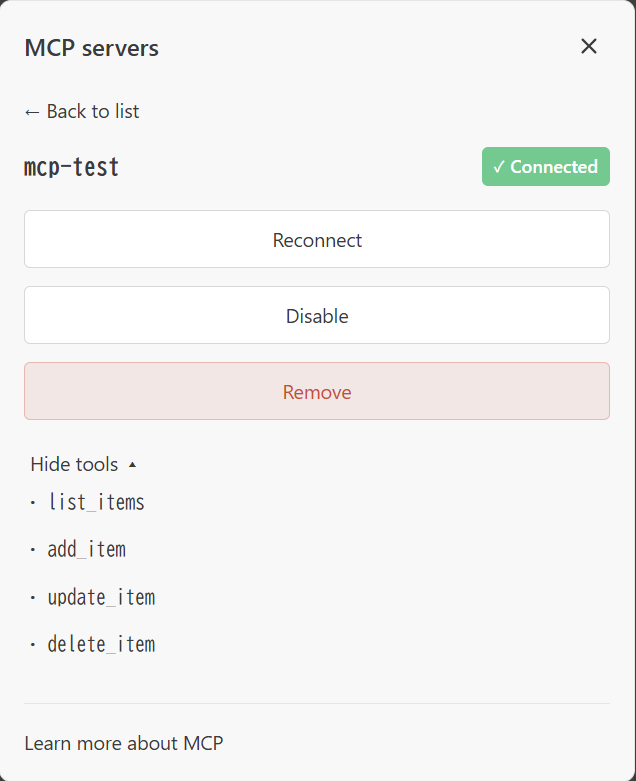
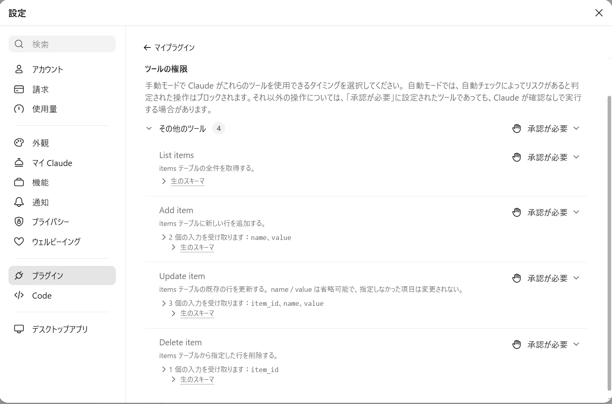
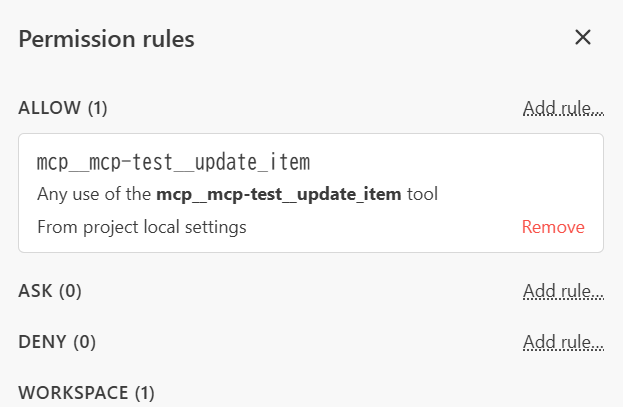
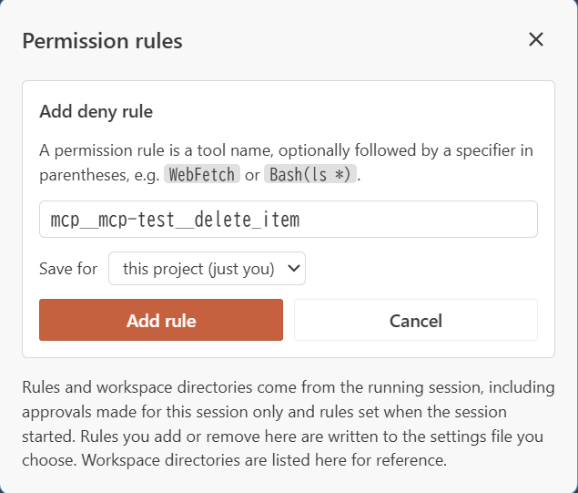
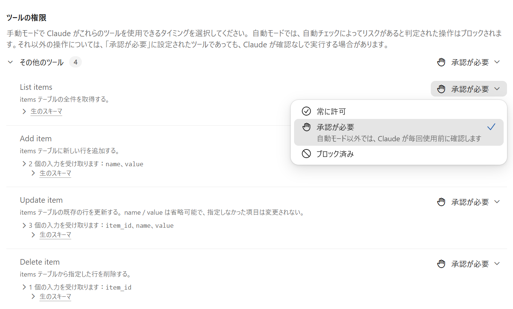
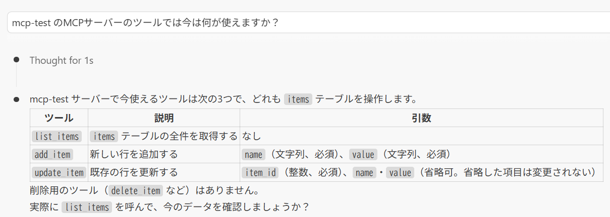

# MCPツールの権限設定

MCPサーバーから配信されているツールは、ツールごとに

- ALLOW : 常に許可
- ASK : 承認が必要
- DENY : ブロック済み

の権限を設定することが出来ます。 
AIが実行中に削除させたくないファイルを削除してしまう恐れがあるため、安全実行するための仕組みとなっています。(ハーネス設計の一部)

典型的には下記のように設定する場合が多いです。

| 設定 | Claude Desktopでの表示 | 動き |向いているツール |
| -- | -- | -- | -- |
|ALLOW | 常に許可 | 確認なしで実行される | 一覧・検索など読むだけのもの |
| ASK | 承認が必要 | 実行前に確認が出る | 作成・更新など書き込むもの |
| DENY | ブロック済み | 使えない | 削除など取り返しのつかないもの |

## MCPサーバーから提供されているツール

MCPサーバーからどんなツールが提供されているかは次のような手順で確認することができます。

### Claude Codeの場合(Visual Studio Codeのサイドパネル)

1. ◩をクリックします。
2. MCP serversを選択します。
3. 好きなMCPを選択します。
4. 「View tools」をクリックします。

### Claude Desktopの場合

1. サイドバーの「プラグイン」をクリックします。
2. 好きなMCPを選択します。

## ツールの権限設定

### Claude Codeの場合(Visual Studio Codeのサイドパネル)

1. ◩をクリックします。
2. Permissionsを選択します。
3. 「ALLOW」、「ASK」、「DENY」内の「Add rule」を選択します。
4. MCPのツールの場合は`mcp__<mcpサーバー名>__<mcpツール名>`のように指定します。`mcp__<mcpサーバー名>__`のところのアンダーバーは2つなので注意してください。
5. 好きなスコープを選択して、「Add Rule」を押すと追加されます。
6. VS Codeを再起動すると設定が反映されます。

### Claude Desktopの場合

1. サイドバーの「プラグイン」をクリックします。
2. 設定したいMCPを選択します。
3. プルダウンメニューを押すと「常に許可」、「承認が必要」、「ブロック済み」が出てくるのでその中から選択します。

## 細かい挙動の紹介

### ASK(承認が必要)の挙動

Claudeには下記の権限モードがあります。

- Claude Code
  - Manual
  - Edit automatically
  - Plan
  - Auto
- Claude Desktop
  - 手動
  - 自動

ASKに設定していると大体の場合は承認が求められますが、「Auto / 自動」モードで動かしている場合は承認なしで実行される場合があります。

### DENY(ブロック済み)の挙動

Denyに設定したツールは、MCPクライアントからAIモデルにツールとして渡されないため、AIモデルはそもそも存在を知らないという状態になります。 
仮に、何かしらの拍子にDenyに登録されているツールの存在を知って、呼び出しが発生してもMCPクライアント側でブロックされるため、MCP経由での呼び出しは不可能になります。

↓`delete_item`をDenyにした時の挙動。

### 複数設定時の挙動

権限ルールは deny → ask → allow の順に評価され、最初にマッチしたルールが使われます。

### Claude Codeの権限設定の補足

`mcp__<mcpサーバー名>__<mcpツール名>`のようにして権限ルールを設定すると先ほど述べましたが、実は`<mcpツール名>`の部分は省略して、

`mcp__<mcpサーバー名>`

のように書くと、そのMCPサーバー全体に対しての設定となります。

他にもワイルドカード一致なども使えるのですが、MCPサーバーのツールで特定の引数が呼ばれた時だけブロックのようなことは、この権限ルール追加では現状できないようでした(2026/10/02)。 
そのようなことを行いたい場合は、hooksのPreToolUse hookで実現します。
